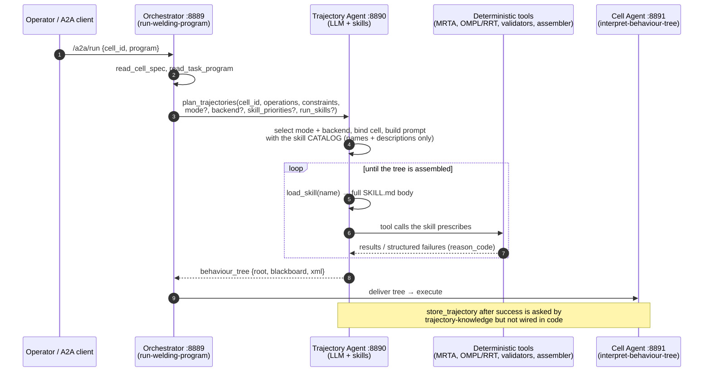
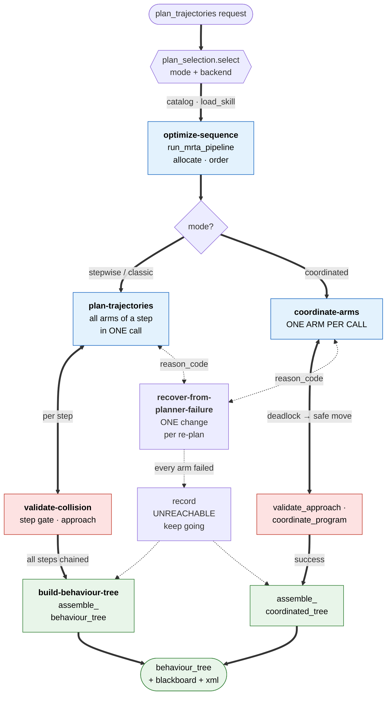
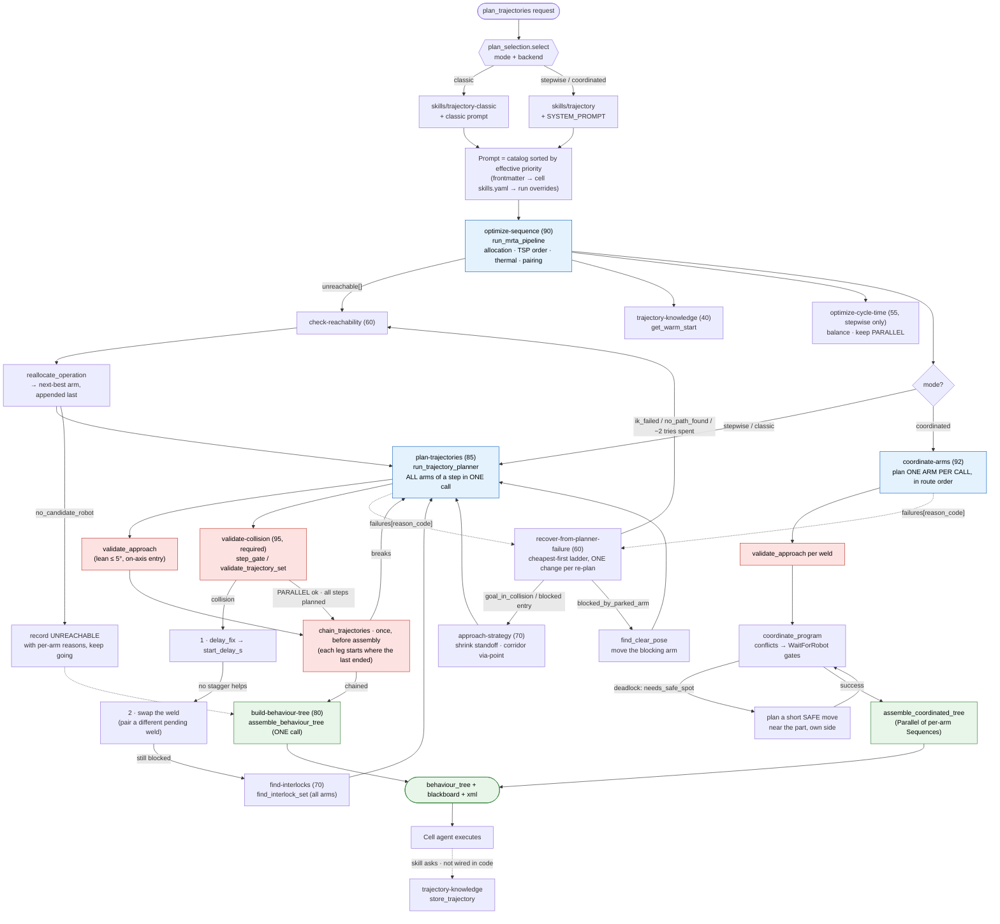

# Trajectory Planning Skills — How They Are Used and Operated

This document explains how the **Trajectory Agent** uses its skills to turn an
operation list (welds, rivets, glue, laser, marks) into a collision-free
**BehaviorTree.CPP v4** tree that the cell agent executes.

- Skills live in `skills/trajectory/` (stepwise + coordinated modes) and
  `skills/trajectory-classic/` (classic mode).
- Skill loading code: `utils/skill_registry.py`, `agents/trajectory/agent.py`
  (`load_skill`, `system_prompt_for`).
- Mode/backend selection code: `agents/trajectory/plan_selection.py`.
- Per-run operator directives: `agents/trajectory/operator_directives.py`.

---

## 1. Where planning sits in the system

The orchestrator (`:8889`, skill `orchestrator/run-welding-program`) reads the
cell spec and the task program. It then calls the trajectory agent's MCP server
(`:8890`, `plan_trajectories`) and sends the returned tree to the cell agent
(`:8891`/`:8892`).



**Division of labour.** The LLM makes the *decisions*: approach standoff, via
points, which arm, recovery, step mode. The tools do all the *math*: IK,
collision, swept-volume checks, timing, chaining and assembly. The agent has no
raw IK/FK or per-config collision tools. The only way to produce motion is
`run_trajectory_planner`.

---

## 2. How skills are loaded (progressive disclosure)

1. **Discovery.** `skill_registry` scans `skills/<agent>/*/SKILL.md` (Agent
   Skills format: YAML frontmatter + markdown body).
2. **Catalog in the prompt.** Only `priority + name + description` of each
   enabled skill goes into the system prompt, sorted **highest priority first**.
3. **On-demand loading.** The LLM calls `load_skill(name)` to read a skill's full
   instructions *before* it acts on a decision that skill governs. A disabled or
   unknown skill is refused, and the refusal lists the available ones.
4. **Conflict rule.** When two skills apply, the higher-priority one wins. A
   lower-priority skill can never override a safety gate.

### Priority layers (later overrides earlier)

| Layer | Where | Scope |
|---|---|---|
| Default | `metadata.priority` in the SKILL.md frontmatter (0–100, default 50) | all cells |
| Cell override | `skills.yaml` in the cell config (`skills: trajectory: <name>: {priority, enabled}`) | one cell, persistent |
| Run override | `plan_trajectories(skill_priorities=…)` | one run, never written |
| Temporary skills | `plan_trajectories(run_skills=[…])` | one run only; cannot replace an existing skill or be `required` |

A skill with `metadata.required: true` (e.g. `validate-collision`) **cannot be
disabled**. Priorities only reorder guidance and never switch a safety check off.
The hard gates (step gate, chain check, approach check, inter-arm check in the
assembler) are enforced in **code**, whatever the skills say.

Admin/MCP tools: `list_skills`, `set_skill_priority`, `validate_run_skills`
(also exposed through the orchestrator's `/a2a/skills` routes).

---

## 3. The skill set

| Priority | Skill | Role | Main tools |
|---:|---|---|---|
| 95 *(required)* | `validate-collision` | Inter-arm swept-volume gate (sphere model, 0.24 m; 0.30 m laser) | `validate_trajectory_set`, `validate_trajectory_pair` |
| 92 | `coordinate-arms` | **Coordinated mode** entry point: per-arm paths, timing by completion gates | `coordinate_program`, `assemble_coordinated_tree` |
| 90 | `optimize-sequence` | **Call first.** MRTA allocation + order (6 stages) | `run_mrta_pipeline` |
| 85 | `plan-trajectories` | Plan-first loop per step: request → plan → verify → recover → chain | `run_trajectory_planner`, `validate_approach`, `chain_trajectories` |
| 80 | `build-behaviour-tree` | One-shot BT.CPP v4 assembly from a compact decision plan | `assemble_behaviour_tree`, `export_behaviour_tree_xml` |
| 70 | `approach-strategy` | Choose the entry (standoff / corridor via-point) around box obstacles; never change the lean | (reasoning over `obstacles.yaml` + failure) |
| 70 | `find-interlocks` | Safe intermediate poses for converging arms | `find_interlock_set`, `find_interlocks` |
| 60 | `recover-from-planner-failure` | `reason_code` → recovery ladder; the single source of truth for recovery | `reallocate_operation`, `find_clear_pose` |
| 60 | `check-reachability` | Reach/IK failure judgement → reallocate or mark unreachable | `reallocate_operation` |
| 55 | `optimize-cycle-time` | Keep steps PARALLEL, balance arms, measure the cycle | `evaluate_program`, `find_clear_pose` |
| 40 | `trajectory-knowledge` | Warm-start KB (`cells/<id>/recordings/trajectory_index.json`) | `get_warm_start`, `get_similar_trajectories`, `store_trajectory` |

`skills/trajectory-classic/` holds the 29 Aug 2026 texts (9 skills, without
`coordinate-arms` and `optimize-cycle-time`). Their frontmatter has no
`priority`, so all of them sort at the default 50.

---

## 4. Planning modes

Each request selects a mode. Precedence: request argument →
`constraints.planning_mode` → stack env `PLANNING_MODE` → code default
**`classic`** (`plan_selection.DEFAULT_PLANNING_MODE`). The backend is selected
the same way (`trajectory_backend` / `TRAJECTORY_BACKEND`, default `ompl`). An
unknown value in the *request* is refused, never silently replaced.

| Mode | Skill set | Prompt | Who owns timing | Assembler |
|---|---|---|---|---|
| `classic` | `trajectory-classic` | `classic_prompt.py` (19 tools) | LLM (steps, `start_delay_s`, interlocks) | `assemble_behaviour_tree` |
| `stepwise` | `trajectory` | `SYSTEM_PROMPT` | LLM, per composed parallel step | `assemble_behaviour_tree` |
| `coordinated` | `trajectory` | `SYSTEM_PROMPT` + `COORDINATED_MODE_PROMPT` | `coordinate_program` (event gates) | `assemble_coordinated_tree` |

> Note: the comment in `agents/trajectory/agent.py` above `CLASSIC_TOOL_NAMES` calls
> `coordinated` the default, but the code default in `plan_selection.py` is
> `classic`. The code wins.

---

## 5. How the skills chain together (main diagram)

<table>
<tr>
<th width="50%">Simple — the skill workflow at a glance</th>
<th width="50%">Detailed — every tool, gate and recovery branch</th>
</tr>
<tr>
<td valign="top">



</td>
<td valign="top">



</td>
</tr>
</table>

Red = verification gates (also re-checked in code by the assembler).
Blue = primary planning skills. Green = deliverable.
Both diagrams share these colors and shapes: stadium = request / deliverable,
hexagon = mode + backend selection, diamond = mode branch. In the simple one,
thick arrows are the main path; dashed arrows are failure → recovery → re-plan
in the same lane.

---

## 6. Step-by-step operation

### Stepwise / classic flow

1. **Allocate and order** with `optimize-sequence` → `run_mrta_pipeline`.
   Allocation is computed here, never inferred from the task. Only
   `assigned_robot` (task file or operator `assignments`) locks an operation; pins
   the model invents are ignored (`ignored_pins`).
   `min_inter_robot_dist_m` is telemetry, **not** clearance (it correlates
   −0.607 with real swept clearance).
2. **Plan each step** with `plan-trajectories`. Use one
   `run_trajectory_planner` call per step with all its arms (or several steps
   via `steps=[[…],[…]]`). Every request has a unique `operation_id`, plus
   `orientation` + `constrain_orientation: true`, `approach: true`, and a chosen
   `approach_offset_m`. Leave out the call-level `velocity_scale`: the cell's
   ceiling applies.
3. **Verify.** `validate_approach` checks each weld's lean and entry. The
   `step_gate` / `validate-collision` result checks each PARALLEL step. Fix a
   conflict *inside the step*, in this order: start delay → different weld →
   interlock. Never serialise the step instead.
4. **Recover.** On any `failures[].reason_code`, load
   `recover-from-planner-failure`. Change one thing per re-plan. After about 2
   attempts per arm, call `reallocate_operation`. A weld is unreachable only when
   every arm has failed it.
5. **Chain.** `chain_trajectories` confirms weld-to-weld continuity.
6. **Assemble once.** `build-behaviour-tree` → `assemble_behaviour_tree(cell_id,
   plan)`. Return the `behaviour_tree` verbatim, including its `blackboard`.

### Coordinated flow

1. `run_mrta_pipeline` supplies **allocation and per-arm order only**. Its step
   pairing is ignored.
2. Plan each arm's route **one arm per call**, choosing `approach_offset_m`,
   `retreat_offset_m` and via-points per weld. Then call `validate_approach`.
3. `coordinate_program(cell_id, sequences)` schedules all arms. An arm that must
   wait holds where it stands, gated by events ("arm X completed op Y"), not by
   clock times.
4. On a `deadlock`, plan a short **safe spot** `move` (`<ns>_SAFE_<n>`) for the
   arm named in `needs_safe_spot`, then coordinate again. Arms that have finished
   are sent home automatically (`early_home`).
5. On success, call `assemble_coordinated_tree` straight away. Don't keep
   iterating to shave seconds off the estimate.

---

## 6b. Planning-time safeguards (from the welding_cell_2_small analysis)

| Behaviour | Where | Switch |
|---|---|---|
| After a **path failure** (`no_path_found`, `excessive_tool_rise`, `trajectory_in_collision`) the **LLM decides**, guided by the skill, whether a longer `approach_offset_m` is the fix (standoff point vs. `obstacles.yaml`, open approach axis) before adding a via point. Nothing in code prescribes it | `recover-from-planner-failure` ("Before any via point, decide on the APPROACH DISTANCE"), `plan-trajectories` step 4 | — |
| **Retry cap**: after 3 failures of one operation on one arm in a run, the planner answers `retry_cap_reached` without solving. Helper waypoints (`_VIA`, `_SAFE`, `_CLEAR`, …) are counted together under their weld | `agents/trajectory/retry_budget.py` | `PLAN_RETRY_CAP` (0 = off) |
| A **batch** (`steps=[…]`) skips only the later steps that move an arm whose step failed; steps moving other arms are planned and kept (`skipped_steps`, `kept_steps_after_stop`) | `planning_tools._plan_steps` | — |
| `ompl-compound` runs its independent solves **at once** in forked children | `backends/ompl_compound/planner.py` | `OMPL_PARALLEL_CANDIDATES` (compose: 1) |
| **Return HOME**: all arms' direct returns are planned at once and kept only when the gate runs them together; otherwise the coupled planner runs as before. An accepted return is reused within the run | `backends/ompl/planner._parallel_direct_home`, `behaviour_tree._home_step` | `HOME_PARALLEL_FASTPATH` (compose: 1) |
| The **allocation** is reused for an unchanged task + cell config (content-fingerprinted) | `tools/plan_memo.py` | `PLAN_MEMO_PROCESS` (compose: 1), `PLAN_MEMO=0` off |
| **Leg store** (across runs): a planned step is reused when the cell config, backend, requests and every arm's pose are unchanged — after every stored leg passes the platform's leg check again (static obstacles included) and the usual contract / joint-limit / step-gate checks. Result carries `reused_step` | `tools/leg_reuse.py`, `planner_backend.dispatch_plan`, `recordings/leg_store.jsonl` | `PLAN_LEG_STORE` (compose: 1) |
| **Path experience** (across runs, Lightning/Thunder-style): paths the compound search found are stored; for a new problem of the same arms the nearest ones are reconnected to the new start/goal and kept only if this step's own checker passes every segment; one within the rise target skips the search | `tools/path_experience.py`, `ompl_compound._solve_compound`, `recordings/path_experience.jsonl` | `PLAN_EXPERIENCE` (compose: 1), `PLAN_EXPERIENCE_MAX_RAD` |
| **Collision checks without Python overhead**: the parked-arm check is one NumPy distance matrix (was a Python double loop, 8.3 ms/state); frame origins transformed in one array op; box margins computed only for nearby boxes; parsed YAML copied with `marshal` instead of `deepcopy` and `robots.yaml` / `cell.yaml` parsed once per content with the C loader. Equivalence held by `tests/trajectory/test_vectorised_collision.py` | `robot_kinematics`, `utils/cell_store.read_yaml`, `utils/cell_layout.load_yaml_text`, `utils/arm_model` | — |
| **Compiled kernels (Numba)**: parked-arm hit, first breached box, robot-pair minimum gap (same branch and bound) and link-fill spheres compiled to machine code, stopping at the first hit; NumPy versions kept as the reference and fallback. Assembler gates 9.0 → 4.5 s, leg checks 2.7 → 1.3 s on welding_cell_2_small, identical verdicts. Machine code cached in `/scratch/numba_cache` (survives restarts) | `tools/fastgeom.py` | `NUMBA_GEOM` (compose: 1; 0 = NumPy), `NUMBA_CACHE_DIR` |
| **No waiting for the slowest arm** (stepwise mode): after a valid stepwise assembly, the same legs are coordinated per arm (event gates only where motions conflict); that tree is returned when it validates and is ≥ 1 s faster (`barrier_free` in the result) | `behaviour_tree._barrier_free` | `plan.barrier_free: false`, `STEPWISE_BARRIER_FREE=0` |

## 7. Invariants every skill respects

- **Never relax the tool lean** (`weld_orientation`). Fix the *path*, not the
  pose. `tool_spin_deg` (spin about the electrode axis) is the only free
  parameter.
- **Never skip collision validation** to save time. `validate-collision` is
  required, and the assembler re-checks it.
- **Never drop an arm or an operation** to dodge a conflict. Reallocate it or
  report it unreachable.
- **Never exceed the cell's speed ceiling** (`planning.max_velocity_scaling`).
- **Always end with a tree.** A run that ends without an assembled tree has
  failed.

---

## 8. Customising skills

```yaml
# cells/<cell_id>/…/skills.yaml   (cell-wide, persistent)
skills:
  trajectory:
    optimize-cycle-time: {priority: 80}      # prefer cycle-time guidance
    trajectory-knowledge: {enabled: false}   # no warm-start for this cell
    # validate-collision: {enabled: false}   # REFUSED — required skill
```

```jsonc
// per run, via plan_trajectories(...)
{
  "skill_priorities": {"approach-strategy": 85},
  "run_skills": [{"name": "fixture-x-notes", "description": "...", "content": "..."}],
  "assignments": {"W012": "robot2"},          // hard lock, enforced in code
  "instructions": "Prefer robot1 for the roof seam."
}
```

To add a permanent skill, create `skills/trajectory/<name>/SKILL.md` with
`name`, `description` and `metadata.priority`. It shows up in the catalog
automatically. See `utils/skill_registry.skill_template()` for the scaffold.
